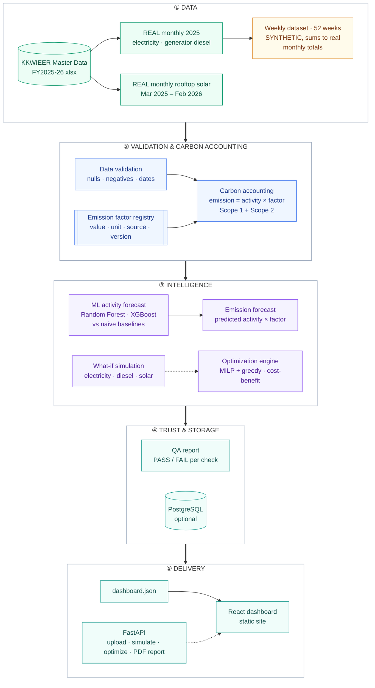

<div align="center">

# Carbonomics-AI

### AI-Driven Carbon Intelligence and Decision Support Framework

Carbon accounting, activity forecasting, what-if simulation and budget-constrained optimization for institutional campuses.


</div>

Final-year project, KKWIEER Nashik (B.Tech Artificial Intelligence & Data Science).
Every emission in this repository is computed as **activity × emission factor** (GHG Protocol).
Machine learning is used only to forecast **activity** (kWh, litres), never emissions, so there is no target leakage.

---

## Read this first: what is real and what is not

| Item | Status |
|---|---|
| Monthly 2025 grid electricity, generator diesel and rooftop solar from the KKWIEER Master Data | **REAL** (`data/real/`) |
| Weekly dataset used to train and test the forecasting models | **SYNTHETIC**: 52 weeks built so that each month sums to the real monthly total. The weekday/weekend shape and the noise are assumptions. Labelled `is_synthetic=True` everywhere |
| Forecast scores | Computed on synthetic data. They show that the pipeline works, **not** real accuracy |
| ML vs baseline | On synthetic electricity data, Random Forest and XGBoost do **not** beat the naive "repeat last week" baseline (see [Results](#results)) |
| Scope coverage | Only **Scope 2 electricity** and **Scope 1 generator diesel** have time series. Commuting, wastewater and the rest are yearly figures only |
| Public demo site | Shows **SAMPLE data**: made-up numbers for a made-up campus. The real campus figures are not shipped in the website |
| Optimization measures | The campus cost inputs in `data/inputs/optimization_measures.csv` are still `TBD`, so no real campus optimization result exists yet. Measures with a missing field are excluded, never defaulted |
| Emission factors | Each factor has a source, version and unit. Four entries are marked `verified=False` in `src/emission_factors.py` and are reported as unverified |

---

## Table of contents

1. [Features](#features)
2. [System architecture](#system-architecture)
3. [Prerequisites](#prerequisites)
4. [Quick start](#quick-start)
5. [Running each part](#running-each-part)
   - [A. Research pipeline](#a-research-pipeline)
   - [B. Dashboard (React)](#b-dashboard-react)
   - [C. Analysis API (FastAPI)](#c-analysis-api-fastapi)
   - [D. Full web app with login (Supabase)](#d-full-web-app-with-login-supabase)
   - [E. PostgreSQL (optional)](#e-postgresql-optional)
   - [F. Other scripts](#f-other-scripts)
6. [Tests](#tests)
7. [Data layout](#data-layout)
8. [Method](#method)
9. [Results](#results)
10. [Repository structure](#repository-structure)
11. [Deployment](#deployment)
12. [Troubleshooting](#troubleshooting)
13. [Roadmap](#roadmap)
14. [License and authors](#license-and-authors)

---

## Features

| Area | What it does |
|---|---|
| Carbon accounting | Scope 1 + Scope 2 from activity data with a factor registry (value, unit, source, version, verified flag) |
| Validation | Rejects bad input (missing, negative, duplicate or unordered dates). Nothing is imputed |
| Forecasting | Weekly activity forecast: Random Forest, XGBoost and Ridge against naive baselines, time-based split, MAE / RMSE / R². An ML model is used only if it beats naive by 5% or more |
| Simulation | What-if on electricity %, diesel % and solar offset. Formula only, no ML. Same result in Python and in the browser (parity checked) |
| Optimization | Best set of measures within a budget (MILP with a greedy comparison). Formula and mathematics only, no ML |
| Energy Audit | kWh per m² against benchmarks, AC inventory and saving ideas, from a master CSV |
| Why it changed | Splits a year-on-year change into an energy-use effect and an emission-factor effect |
| Upload | Analyse your own CSV or Excel file (daily, weekly or monthly) |
| Report | PDF report generated on the server; numbers are recomputed there, not copied from the browser |
| History | Saved analyses and plans per logged-in user (Supabase, row level security) |

Dashboard pages: Overview, Trends, Forecast, Simulation, Optimization, Energy Audit, Why it changed (your own data only), Upload your data, History.

---

## System architecture



Green = real data, amber = synthetic, blue = accounting, purple = intelligence, teal = delivery.

| Layer | What it does | Where |
|---|---|---|
| ① Data | Real monthly electricity, generator diesel and rooftop solar; a 52-week **synthetic** dataset that sums to the real monthly totals | `data/real/`, `scripts/make_synthetic_weekly.py` |
| ② Accounting | Validates data, then computes Scope 1 + 2 with cited factors (CEA V21.0, IPCC 2006) | `src/clean_data.py`, `src/emission_factors.py`, `src/process_dataset.py` |
| ③ Intelligence | Forecasts weekly activity against baselines; simulation and optimization on the real monthly baseline | `src/ml/`, `src/simulation.py`, `src/optimization.py` |
| ④ Trust & storage | QA report with PASS/FAIL per check; optional PostgreSQL upsert | `src/validation/`, `src/database/`, `database/` |
| ⑤ Delivery | Static React site (reads one JSON file) plus a small FastAPI service for uploads, simulation, optimization and the PDF report | `dashboard/`, `api/`, `src/dashboard_export.py` |

### Key numbers (real data, calendar year 2025)

| Source | Activity | Emissions |
|---|---|---|
| Grid electricity (Scope 2) | 1,059,147 kWh | 752.0 tCO₂e |
| Generator diesel (Scope 1) | 4,100 L | 11.9 tCO₂e |
| Rooftop solar (avoided, reported separately, not netted) | 21,720 kWh | 15.42 tCO₂e avoided |

Electricity and generator diesel are about **20.5%** of the 3,719.74 tCO₂e campus footprint (`REPORT_FOOTPRINT_TCO2E` in `src/emission_factors.py`).
The rest, mainly commuting and wastewater, has no time series.

---

## Prerequisites

| Tool | Version | Needed for |
|---|---|---|
| Python | 3.12 or newer (checked with 3.13; the Render config pins 3.12.8) | pipeline, API, tests |
| pip | recent | Python packages |
| Node.js and npm | Node 20.19+ or 22.12+ (checked with Node 22) | dashboard |
| Git | any | cloning |
| PostgreSQL | 14+ (optional) | only if you want the database step |
| Supabase project | optional | only for login and History on a hosted setup |

---

## Quick start

```bash
git clone https://github.com/sanket1035/carbonomics-ai.git
cd carbonomics-ai

# 1. Python environment
python -m venv .venv
source .venv/bin/activate            # Windows PowerShell: .venv\Scripts\Activate.ps1
pip install -r requirements.txt

# 2. Run the full research pipeline (about a minute)
python scripts/run_pipeline.py

# 3. Run the tests (about 1.5 minutes)
pytest tests

# 4. Start the API (terminal 1, repository root)
AUTH_DISABLED=1 uvicorn api.main:app --port 8000     # Windows PowerShell: $env:AUTH_DISABLED=1; uvicorn api.main:app --port 8000

# 5. Start the dashboard (terminal 2)
cd dashboard
npm install
npm run dev                          # http://localhost:5173
```

You can skip steps 1 to 4 and run only step 5 to look at the demo pages. The committed
`dashboard/public/data/dashboard.json` is SAMPLE data, so the site works without Python.
Upload and History need the API from step 4.

`AUTH_DISABLED=1` switches off the login check. It is for local development only and must never be set on a real server.

---

## Running each part

### A. Research pipeline

```bash
python scripts/run_pipeline.py
```

Run it from anywhere; it switches to the repository root itself. Steps:

| Step | What happens | Output |
|---|---|---|
| 1/7 | Build the weekly SYNTHETIC dataset from the real monthly totals | `data/synthetic/weekly_synthetic.csv`, `weekly_synthetic_metadata.json` |
| 2/7 | Validate the weekly dataset | `data/processed/weekly_clean.csv` |
| 3/7 | Carbon accounting (activity × factor) | `outputs/weekly_emissions.csv` |
| 4/7 | Forecast weekly activity with baselines, then derive the emission forecast | `outputs/forecast/`, `outputs/plots/`, `outputs/models/` (models are git-ignored) |
| 5/7 | QA report | `outputs/qa_report.md` |
| 6/7 | PostgreSQL upsert (skipped when `DB_PASSWORD` is not set) | database tables |
| 7/7 | Export dashboard data from the **real** figures | `outputs/dashboard_real.json` |

Notes:

- Step 7 writes `outputs/dashboard_real.json`. It is deliberately **not** served by the public site. The file the website reads, `dashboard/public/data/dashboard.json`, is made by `scripts/make_demo_data.py` from SAMPLE numbers.
- Re-running rewrites files in `data/synthetic/`, `data/processed/` and `outputs/`. The seed is fixed, so the data files come out the same; the PNG plots may differ in bytes.
- To run only the forecast (needs `data/processed/weekly_clean.csv` from a previous run): `python scripts/run_weekly_forecast.py`.

### B. Dashboard (React)

Static site: Vite, React, Tailwind, Recharts.

```bash
cd dashboard
npm install
npm run dev          # development server, http://localhost:5173
npm run build        # production build in dashboard/dist (relative paths, works on any host or sub-path)
npm run preview      # serve the production build locally
```

- The demo pages (Overview to Energy Audit) read `public/data/dashboard.json`. No server needed.
- **Upload your data** and **History** call the API. Their address and the login settings are fixed at build time through `dashboard/.env.example` (copy it to `dashboard/.env.local`):

  | Variable | Meaning |
  |---|---|
  | `VITE_API_URL` | API address, default `http://localhost:8000` |
  | `VITE_SUPABASE_URL` | Supabase project URL (optional for local use) |
  | `VITE_SUPABASE_ANON_KEY` | Supabase public anon key (optional for local use) |

  All three are public by design. Never put a service-role key or a password there.
- Without the two Supabase settings (local development) the locked pages stay open and the API decides what it accepts, so start the API with `AUTH_DISABLED=1`.
- Routes are hash based (`#home`, `#login`, `#overview`, `#upload`, `#history`, ...), and `#demo/<page>` always shows the sample-data demo.
- Check that the browser Simulation and Optimization agree with Python (from the repository root):

  ```bash
  node scripts/parity_check.js
  node scripts/optimization_parity.js
  ```

### C. Analysis API (FastAPI)

```bash
pip install -r requirements.txt            # or requirements-api.txt for a server install
AUTH_DISABLED=1 uvicorn api.main:app --reload --port 8000     # from the repository root
```

Interactive docs: http://localhost:8000/docs

| Endpoint | Purpose |
|---|---|
| `GET /api/health` | Health check (no login needed) |
| `POST /api/analyze` | Upload a CSV or Excel file: validation, accounting, forecast (weekly or daily data with 26+ weeks), Energy Audit if the file has the sections |
| `POST /api/simulate` | What-if on the periods returned by `/api/analyze` |
| `POST /api/optimize` | Best measures within a budget, from measures you supply |
| `POST /api/factor-change` | Use effect vs emission-factor effect between two years |
| `GET /api/grid-factors` | Grid emission factor versions |
| `GET /api/campus-footprint` | Yearly campus footprint from the published report (shown beside, never added to, your totals) |
| `POST /api/report` | PDF report |
| `GET /api/runs`, `GET/DELETE /api/runs/{id}` | Saved history (needs Supabase) |

Try it:

```bash
curl -F file=@data/real/real_monthly_2025.csv http://localhost:8000/api/analyze
```

Rules the upload follows:

- Accepted: daily, weekly or monthly rows with a date column and electricity (kWh) and/or generator diesel (litres). Limit 5 MB and 100,000 rows. Files are processed in memory and not stored.
- Monthly files get accounting only. Weekly or daily files with at least 26 weeks also get a forecast.
- A model is used only if it beats the naive last-week baseline by 5% or more on a time-ordered test split. Otherwise the naive forecast is returned and the response says so.
- For the Energy Audit, upload one master CSV with a `section` column: `weekly`, `building` and `ac` rows. The annual basis needs about a year of data (40+ weeks or 10+ months). Nothing is filled in.

Environment variables:

| Variable | Meaning |
|---|---|
| `ALLOWED_ORIGINS` | Comma-separated site addresses allowed by CORS (default `http://localhost:5173`) |
| `SUPABASE_URL`, `SUPABASE_ANON_KEY` | Login check and history (see D) |
| `AUTH_DISABLED=1` | Local development only: no login check, no history |

### D. Full web app with login (Supabase)

Without Supabase the API cannot verify logins and keeps no history. To run the whole app as deployed:

1. Create a Supabase project, switch **Allow new users to sign up** off, and create the accounts yourself.
2. Run `supabase/migrations/001_profiles_and_runs.sql`, then `002_optimization_runs.sql` in the SQL editor.
3. Set `SUPABASE_URL`, `SUPABASE_ANON_KEY` and `ALLOWED_ORIGINS` for the API, and the three `VITE_*` variables for the dashboard build.

Details and the limits of the free plan: [`supabase/README.md`](supabase/README.md) and [`docs/DEPLOY.md`](docs/DEPLOY.md).

### E. PostgreSQL (optional)

Used only by step 6 of the pipeline: the weekly activity and forecast tables.

```bash
cp .env.example .env     # then edit the values and export them in your shell
export DB_HOST=localhost DB_PORT=5432 DB_NAME=carbonomics_db DB_USER=postgres DB_PASSWORD=...
python scripts/run_pipeline.py     # creates the tables if needed and upserts; safe to run twice
python scripts/verify_db.py        # prints row counts and sample rows
```

The code reads these as environment variables and does not load `.env` itself. Without `DB_PASSWORD` the step is skipped with a message. See [`database/README.md`](database/README.md).

### F. Other scripts

| Command | What it does |
|---|---|
| `python scripts/make_demo_data.py` | Rebuilds `dashboard/public/data/dashboard.json` from SAMPLE numbers (fixed seed) |
| `python scripts/make_synthetic_weekly.py` | Only rebuild the synthetic weekly dataset |
| `python scripts/scope3_commuting.py <survey.xlsx> [population]` | Scope 3 student commuting from a transport survey file |
| `python -I validation/bdg2/run_bdg2_validation.py <bdg2_dir> <repo_dir> <out_dir>` | External check of the forecasting protocol on public building data. Needs the BDG2 files, which are not in the repository (see `validation/bdg2/README.md`) |

---

## Tests

```bash
pytest tests              # everything
pytest tests/test_pipeline.py -q
```

On Python 3.13 the full suite (267 tests) passed in about 85 seconds. It covers emission factors, accounting, the weekly pipeline, forecasting and model selection, simulation, optimization, upload analysis, the Energy Audit, report pages, the login check and history calls (with a fake signing key and fake REST API), and the demo-data check that no real campus figure leaks into the public sample file.

---

## Data layout

| Path | Content | Status |
|---|---|---|
| `data/real/real_monthly_2025.csv` | Monthly electricity (kWh) and generator diesel (L), 2025 | REAL |
| `data/real/real_solar_monthly.csv` | Monthly rooftop solar generation, Mar 2025 – Feb 2026 | REAL |
| `data/real/KKWIEER_Carbon_Footprint_Master_Data_FY2025-26.xlsx` | Source workbook | REAL |
| `data/real/ac_inventory.csv`, `campus_facts.csv`, `annual_inventory_fy2025_26.csv`, `campus_footprint_report_fy2025_26.csv` | Energy Audit and yearly footprint inputs | REAL |
| `data/synthetic/weekly_synthetic.csv` | 52 weekly rows, `is_synthetic=True` | SYNTHETIC |
| `data/synthetic/weekly_synthetic_metadata.json` | Seed and the assumptions used | SYNTHETIC |
| `data/processed/weekly_clean.csv` | Validated weekly dataset | derived |
| `data/inputs/optimization_measures.csv` | Candidate measures; cost fields still `TBD` | incomplete |
| `data/inputs/energy_audit_suggestions.csv` | Energy Audit saving ideas | input |
| `outputs/` | Emissions, forecasts, metrics, plots, QA report, Scope 3 results | generated |
| `dashboard/public/data/dashboard.json` | What the public website reads | SAMPLE |

See [`docs/weekly_synthetic_forecast.md`](docs/weekly_synthetic_forecast.md) for what is real, what is assumed and how to read the scores.

---

## Method

- **Accounting.** `emission = activity × emission factor`. Factors live only in `src/emission_factors.py`, each with value, unit, source, version and a `verified` flag. Grid electricity uses the CEA CO₂ Baseline Database (V21.0); diesel is documented there too.
- **Forecast target.** Weekly `electricity_kwh` and `diesel_litres` (activity). Emission is computed afterwards as predicted activity × factor.
- **Features.** Past-only: lag 1, 2 and 4 weeks, 4-week rolling mean, month and ISO week.
- **Split.** Time-based, first 80% of weeks train and last 20% test (38 and 10 weeks). No random split.
- **Models and baselines.** Random Forest and XGBoost against naive last week and training mean. The upload path also tunes Ridge by rolling-origin validation.
- **Metrics.** MAE, RMSE, R², always shown next to the naive baseline.
- **Acceptance gate.** A model is used only if its test MAE is at least 5% below naive.
- **Simulation and optimization.** Formula and mathematics (MILP via `scipy.optimize.milp`, greedy for comparison). No ML.

---

## Results

Weekly forecast on the **synthetic** dataset (from `python scripts/run_pipeline.py`, 10 test weeks):

| Target | Model | MAE | RMSE | R² |
|---|---|---|---|---|
| Electricity (kWh) | naive last week | 832 | 932 | 0.36 |
| Electricity (kWh) | train mean | 2,780 | 3,013 | -5.71 |
| Electricity (kWh) | Random Forest | 1,210 | 1,382 | -0.41 |
| Electricity (kWh) | XGBoost | 1,741 | 2,062 | -2.14 |
| Diesel (L) | naive last week | 13.9 | 19.0 | -2.66 |
| Diesel (L) | train mean | 30.5 | 32.1 | -9.49 |
| Diesel (L) | Random Forest | 18.4 | 21.0 | -3.49 |
| Diesel (L) | XGBoost | 13.8 | 18.3 | -2.40 |

Electricity: the naive baseline wins. Diesel: XGBoost is on par with naive and both have negative R². These numbers come from synthetic data and show that the pipeline works, not real accuracy. The latest values are always in `outputs/forecast/weekly_metrics.csv`.

**External check on public data.** The same protocol (time split, naive baseline, 5% gate) was run on 58 education buildings from the public Building Data Genome 2 dataset. The gate accepted ML in about a quarter of them (14 of 58) and fell back to naive in the rest. The claim this supports is that the protocol is conservative by design, not that ML forecasts electricity better than a naive baseline. Details and limits: [`validation/bdg2/README.md`](validation/bdg2/README.md).

---

## Repository structure

```
carbonomics-ai/
├── api/                  FastAPI service (main.py, auth.py, history.py)
├── assets/               fonts and images used in the PDF report
├── dashboard/            React dashboard (Vite, Tailwind, Recharts)
│   ├── public/data/      dashboard.json (SAMPLE demo data)
│   └── src/pages/        Overview, Trends, Forecast, Simulation, Optimization, EnergyAudit, Upload, History, ...
├── data/
│   ├── real/             real monthly data and campus inventories
│   ├── synthetic/        weekly SYNTHETIC dataset and its metadata
│   ├── processed/        validated weekly dataset
│   └── inputs/           optimization measures, energy audit suggestions
├── database/             schema.sql, import.sql, README
├── docs/                 DEPLOY.md, weekly_synthetic_forecast.md, ml_model_comparison.md, reports
├── outputs/              emissions, forecasts, plots, QA report, Scope 3 results
├── scripts/              run_pipeline.py, make_synthetic_weekly.py, make_demo_data.py, parity checks, ...
├── src/
│   ├── emission_factors.py, calculations.py, clean_data.py, process_dataset.py
│   ├── simulation.py, optimization.py, energy_audit.py, factor_change.py
│   ├── upload_analysis.py, upload_audit.py, upload_optimization.py
│   ├── report_*.py       PDF report builders
│   ├── ml/               forecast_weekly.py, model_selection.py, visualizer.py
│   ├── validation/       QA checks and report
│   └── database/         PostgreSQL manager
├── supabase/             migrations and setup notes for login and history
├── tests/                pytest suite
├── validation/bdg2/      external check on public building data
├── render.yaml           Render blueprint for the API
├── requirements.txt      full environment (pipeline, tests, API)
└── requirements-api.txt  only what the API needs
```

---

## Deployment

| Part | Host | Config |
|---|---|---|
| Website (`dashboard/`) | Vercel or Netlify, root directory `dashboard`, build `npm run build`, output `dist` | `dashboard/vercel.json`, `dashboard/netlify.toml` |
| API (`api/`) | Render, from the blueprint | `render.yaml`, `requirements-api.txt` |
| Login and history | Supabase | `supabase/` |

Step by step, including free-plan limits (Render sleeps after 15 minutes idle, so open the site a couple of minutes before a demo): [`docs/DEPLOY.md`](docs/DEPLOY.md).

---

## Troubleshooting

| Problem | Fix |
|---|---|
| Upload page says "Could not reach the analysis server" | Start the API from the repository root: `AUTH_DISABLED=1 uvicorn api.main:app --port 8000`, and check `VITE_API_URL` |
| Browser blocks API calls (CORS) | Add the site address to `ALLOWED_ORIGINS` on the API (default allows `http://localhost:5173` only) |
| API returns 401 | A login is required. Locally, start the API with `AUTH_DISABLED=1`; on a server, configure Supabase |
| `ModuleNotFoundError` | Activate the virtual environment and run `pip install -r requirements.txt` |
| `npm run dev` fails on an old Node | Use Node 20.19+ or 22.12+ |
| PostgreSQL step says SKIPPED | Expected when `DB_PASSWORD` is not set |
| First request on the hosted API takes about a minute | Render free plan wakes from sleep |
| `git status` shows changed PNGs after the pipeline | The plots are regenerated; restore them with `git checkout outputs/plots` if you do not want them in a commit |

---

## Roadmap

Done:

- Carbon accounting with a cited factor registry (Scope 1 + Scope 2), rooftop solar shown separately
- Weekly synthetic dataset calibrated to real monthly totals, validation and QA report
- Weekly activity forecast with naive and mean baselines, emission forecast, saved models
- What-if simulation and budget-constrained optimization
- React dashboard, CSV/Excel upload API, Energy Audit, factor-change attribution, PDF report, login and history
- Automated tests and an external check of the forecasting protocol on public data

Open:

- Forecast on real weekly data (the Energy team has not provided any)
- Scope 3 forecasting (no weekly activity data)
- Real cost, yield and lifetime inputs for the campus optimization measures
- Four emission factors still unverified against the Master Data
- Electric vehicle adoption simulation (no time series)
- Real-time IoT data, carbon credit estimation, net-zero planning, multi-institution benchmarking

---

## License and authors

Copyright © 2026 Team Carbonomics. All rights reserved.
This code is published for viewing and evaluation only. See [`LICENSE`](LICENSE).
For permission to use it, contact Carbonomics.app@gmail.com

Developed as an academic and portfolio project. Unauthorized plagiarism or direct submission as one's own academic work is prohibited.

**Sanket Chaudhari**, B.Tech Artificial Intelligence & Data Science
[GitHub](https://github.com/sanket1035) · [LinkedIn](https://linkedin.com/in/sanketchaudhari1035)
